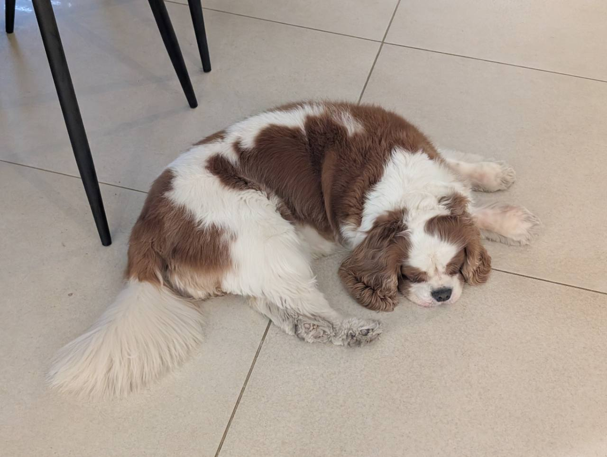

<p align="center">
  
</p>

# Mapple

Explore Linux from the kernel, through an HTTPS API and a terminal interface.

Mapple combines a C kernel module, a Go server, and a Go TUI. Inspect processes
and threads, query module capabilities, and send echo requests through a live
kernel session. An Ubuntu/QEMU development lab brings the whole stack together,
with source breakpoints, kernel stepping, and navigation into Linux definitions.

```text
Ubuntu host                                  Ubuntu QEMU guest

mapple TUI ── HTTPS ── mappled ── TCP ──────── mapple.ko
                           Go server          C kernel module

VS Code / GDB TUI ── QEMU GDB stub ────────── kernel + module
```

The server also supports a local `/dev/mapple` character device when it runs on
the module's machine. The TUI communicates through the server's authenticated
HTTPS API.

## Get started

Use an **x86-64 Ubuntu 24.04 host** with sudo and an internet connection. KVM is
recommended. Allow at least **10 GiB free for the kernel build**, plus room for
the Ubuntu image and VM disk growth. The default guest uses 4 GiB RAM and 2 CPUs;
see the [setup guide](docs/guides/setup.md) for prerequisites and smaller VM settings.

```bash
sudo apt-get update
sudo apt-get install -y git make python3
git clone https://github.com/GhostDog788/Mapple.git
cd Mapple
make setup
make kernel-create NAME=baseline VERSION=6.6.6 PROFILE=debug
make kernel-build KERNEL=baseline
make machine-create NAME=dev KERNEL=baseline
make machine-start
make machine-prepare
make module-run
```

`make setup` installs the remaining host tools. The first machine is selected
automatically. `kernel-build` compiles Linux once; `machine-prepare` installs it,
reboots, and verifies the guest. Other machines can reuse the same kernel slot.

Start the server in one terminal:

```bash
make server-run
```

From the repository root in another terminal, launch the TUI:

```bash
make tui-run
```

Inside the TUI:

```text
session create dev
command info
command echo hello
command pslist
```

You now have a session to the module running in the guest. `command pslist`
opens a process and thread snapshot; press Esc to return to the command prompt.
For a terminal-only host, launch the TUI
with `make tui-run FOREGROUND=1`.

## Develop and debug

Use `make module-build`, `make server-build`, or `make tui-build`. Reload Mapple
with `make module-run`, and run repository checks with `make check`.

For VS Code, install the recommended C/C++ and clangd extensions, run
`make vscode-open`, and press **F5** in the generated machine workspace. Set
breakpoints in `kernel/src/` and trigger requests from the TUI. For GDB TUI, run
`make module-debug`, create a fresh TUI session, then run `make gdb-open`.
The [debugging guide](docs/guides/usage.md#kernel-debugging) walks through both flows.

Manage machines with `make machine-list` and `make machine-use NAME=...`.
`MACHINE=...` overrides the destination for one command. `make kernel-list`
shows reusable kernel slots and their development tiers. The
[usage guide](docs/guides/usage.md) covers kernel switching, source navigation,
and simultaneous development on multiple machines.

## Documentation

The [documentation index](docs/README.md) organizes guides, architecture, and
reference material.

| Guide | What you will find |
| --- | --- |
| [Setup](docs/guides/setup.md) | From a fresh Ubuntu host to a working lab; new or existing QEMU VMs |
| [Usage](docs/guides/usage.md) | Daily development, every Make target and option, debugging, and troubleshooting |
| [Architecture](docs/architecture/overview.md) | Components, transports, API, and session ownership |
| [Server installation](docs/guides/server-installation.md) | Deploying the Go server and TUI outside the local lab |

The application lives in [`kernel/src/`](kernel/src), [`shared/`](shared), and
[`user/`](user). Development tooling lives in [`scripts/`](scripts) and
[`scripts/mapple_dev/`](scripts/mapple_dev). Private lab state and VM disks stay in the
gitignored `.lab/` directory.

## Meet Mapple

This project is named after my dog, **Mapple**. “Mapple” is how I spell her name
in English. It started as a spellig mistake when I was 14 and I caried it on :)


